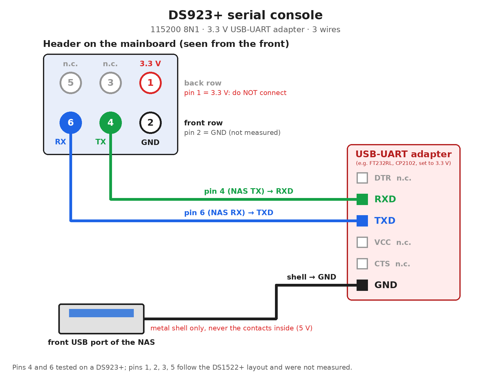

# Serial console

The DS923+ has an internal serial port. It is not needed to install or run synodeb, but it
shows everything the network cannot: the firmware, the boot menu of the DOM, kernel messages
and a login prompt. It helps when a system does not come up on the network.

- **Header**: 2×3 pins, 2.0 mm pitch, on the mainboard behind the front grille. It can be
  reached from below, through the grille, with the NAS closed.
- **Signals**, front row (pins 6-4-2, from the left, seen from the front): pin 6 is RX of the
  NAS (to TXD of the adapter), pin 4 is TX of the NAS (to RXD of the adapter), pin 2 is GND.
  Pin 1, in the back row, carries 3.3 V: **do not connect it**.
- **Ground**: pin 2, or the metal shell of the front USB port (the shell only, never the
  contacts inside, which carry 5 V).
- **Adapter**: any USB-UART adapter **at 3.3 V** (FT232RL, CP2102, CH340…). A 5 V adapter
  can damage the NAS.
- **Settings**: 115200 baud, 8N1, no flow control (e.g. `picocom -b 115200 /dev/ttyUSB0`).
- Do not power the NAS off with the adapter connected: the adapter would feed the SoC through
  the RX line.

What you see:

| stage | |
|---|---|
| firmware | BIOS messages |
| DOM boot menu | the Synology boot loader with the DSM entries and *DEBIAN*, *DEBIAN_OLD* (*INSTALLER* while installing); arrows and Enter work |
| Debian | kernel messages and a login prompt (`console=uart8250,mmio32,0xfedc9000,115200n8`) |
| DSM | DSM's own console on ttyS0 |

Pins 4 and 6 were tested on a DS923+. The positions of pins 1, 2, 3 and 5 follow the
documented layout of the DS1522+, which uses the same header, and were not measured.
